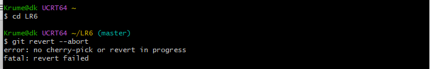
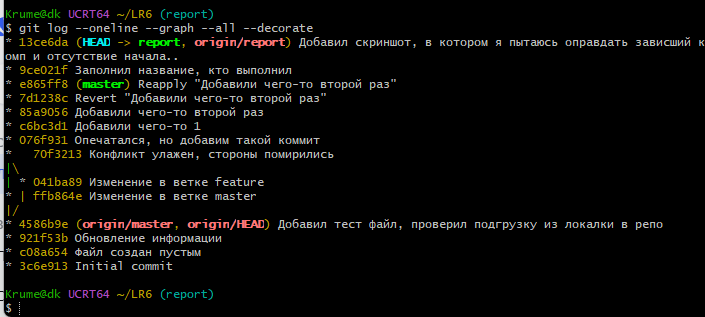
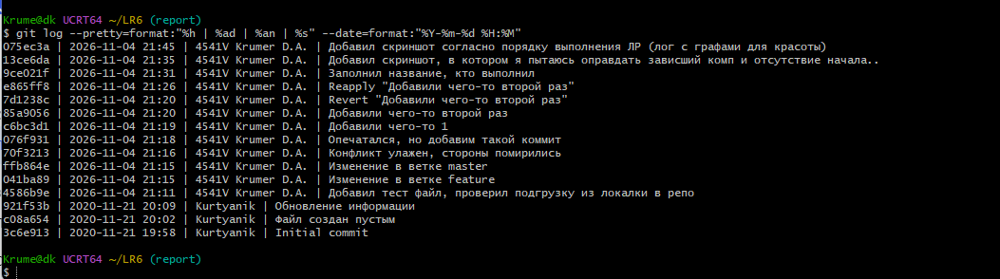

Отчет по ЛР6: Контроль версий, git
Выполнил студент 4541В Крумер Д. А.
===

Работа оказалась достаточно интересной, несмотря на совпадение темы с информатикой первого курса. Четкая формулировка задач вынуждает обращаться к интернету для поиска информации, значит есть прогресс. Извините за скудный по кол-ву скриншотов отчет, писал его после работы, и не ожидал подставы от revert, из-за которой пришлось возвращаться к началу. Спасибо.
